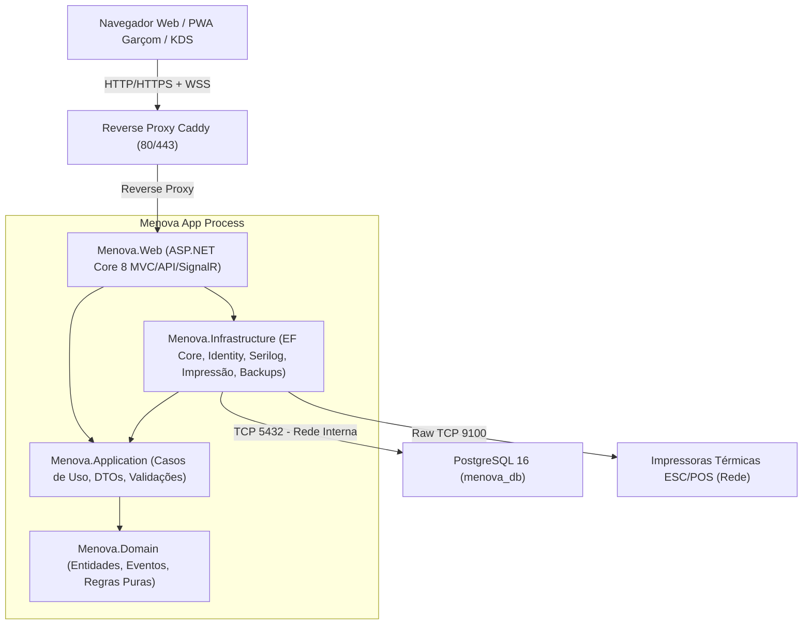

# Arquitetura do Sistema MENOVA

O **Menova** é um sistema monólito modular de alta performance, desenhado para restauração e hotelaria, operando de forma 100% autónoma na rede local do restaurante.

---

## 1. Visão Geral da Arquitetura

---

## 2. Camadas do Sistema (Clean Architecture)

1. **`Menova.Domain`**:
   - Zero dependências externas de infraestrutura.
   - Entidades base (`BaseEntity`, `AuditableEntity`, `SoftDeletableEntity`).
   - Módulos de domínio: `Identity`, `Configuracao`, `Auditoria`, `Sala`, `Menu`, `Estacoes`, `Pedidos`, `Caixa`, `Impressao`, `Relatorios`.
   - Regras de negócio puras: cálculo de IVA 16% Moçambique, disponibilidade por regra 86 (`EstaDisponivelParaVenda`), cálculo do hash criptográfico WORM de auditoria.

2. **`Menova.Application`**:
   - DTOs limpos e imutáveis (`record`).
   - Interfaces de abstração (`IAppDbContext`, `IContaService`, `IPedidoService`, `IKdsService`, `ICaixaService`, `IPagamentoService`, `IFechoZService`, `IImpressaoService`, `IRelatorioService`, `IBackupService`).
   - Catálogo centralizado de permissões e perfis (`PermissoesCatalogo.cs`).

3. **`Menova.Infrastructure`**:
   - Mapeamentos de persistência com `EF Core` e `Npgsql`.
   - Triggers WORM em PL/pgSQL na base de dados (`fn_bloquear_mutacao_auditoria`) que blindam as tabelas `auditoria` e `documentos_z`.
   - Gerador de comandos térmicos ESC/POS (`EscPosGenerator`) com CodePage 860 português e 42 colunas.
   - Motor de exportação de relatórios em Excel (`ClosedXML`), PDF executivo (`QuestPDF`) e CSV com UTF-8 BOM.
   - Motor de backup com `pg_dump` e fallback nativo comprimido com rotação automática.

4. **`Menova.Web`**:
   - ASP.NET Core MVC para o Painel Administrativo do Restaurante.
   - PWA para telemóveis e tablets dos garçons (`/garcom`), com suporte offline via Service Worker (`sw.js`) e **Modo de Apresentação ao Cliente**.
   - Ecrã KDS da Cozinha e Bar (`/kds`) com alertas sonoros nativos e tempos de espera por cores.
   - SignalR Hub (`/hub/menova`) para sincronização instantânea em tempo real de mesas, comandas e regra 86.
   - Design System Primavera Classic ERP Vinho (`#6E1A33`), bordas de 2px, sem gradientes.

---

## 3. Padrão Moçambique e Regionalização

- **Fuso Horário**: `Africa/Maputo` (CAT / UTC+2) forçado via `DateTimeService`. No PostgreSQL, todos os carimbos são persistidos em UTC (`timestamptz`).
- **Moeda**: Metical (**MZN**), símbolo `MT` com 2 casas decimais.
- **Identificação Fiscal**: NUIT com 9 dígitos.
- **IVA**: Taxa legal de 16% incluída nos preços de retalho ao consumidor.

---

## 4. Segurança e Resiliência

1. **Zero CDN**: 100% dos recursos estáticos (Bootstrap 5.3, Bootstrap Icons, Chart.js, SignalR) são servidos a partir do contentor local.
2. **Confirmações Seguras**: Nenhum `alert()`, `confirm()` ou `prompt()` do navegador é utilizado. Todas as interações críticas utilizam `#globalConfirmModal`.
3. **Idempotência**: Requisições de pedidos e pagamentos utilizam o cabeçalho `Idempotency-Key` com armazenamento temporário na tabela `chaves_idempotencia`.
4. **Proteção de Segredos**: Palavras-passe encriptadas com PBKDF2 (100.000 iterações) e PINs de supervisor protegidos com salt e pepper de segurança.
