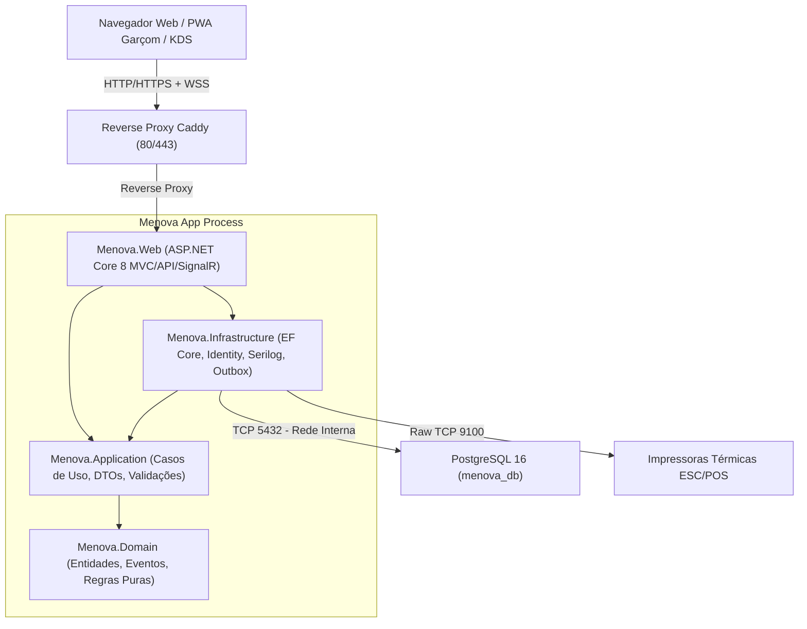

# Arquitetura do Sistema MENOVA

O **Menova** é um sistema monólito modular de alta performance, desenhado para restauração e hotelaria, operando de forma 100% autónoma na rede local do restaurante.

---

## 1. Visão Geral da Arquitetura

---

## 2. Camadas do Sistema

1. **`Menova.Domain`**:
   - Zero dependências de infraestrutura ou bibliotecas de terceiros.
   - Contém entidades base (`AuditableEntity`, `SoftDeletableEntity`), entidades de negócio (`Utilizador`, `Perfil`, `Permissao`, `RegistoAuditoria`, etc.), enumeradores e eventos de domínio.
   
2. **`Menova.Application`**:
   - Casos de uso (comandos e queries), interfaces de persistência (`IAppDbContext`), interfaces de auditoria (`IAuditoriaService`), serviço de utilizador atual (`ICurrentUserService`), validações com `FluentValidation` em pt-PT e catálogo de permissões granulares.

3. **`Menova.Infrastructure`**:
   - Implementação de persistência com `EF Core` e `Npgsql`.
   - Implementação do `ASP.NET Core Identity` adaptado ao esquema relacional do Menova.
   - Triggers WORM em PL/pgSQL na base de dados para proteção da tabela de auditoria.
   - Cálculo criptográfico de hash da cadeia de auditoria.
   - Logging estruturado com Serilog e correlação de pedidos.

4. **`Menova.Web`**:
   - ASP.NET Core MVC para o Painel Administrativo.
   - Minimal APIs / Controllers para o PWA do Garçom e Ecrãs de Cozinha (KDS).
   - SignalR Hubs para sincronização em tempo real (mesas, pedidos, chamadas).
   - Design System Vinho & Branco (#6E1A33) com bordas de 2px e sem gradientes.
   - Filtros de segurança: Rate Limiting, Anti-CSRF, Security Headers (CSP estrito, HSTS, X-Content-Type-Options).
   - Forçamento do Fuso Horário `Africa/Maputo` e Formatação Moçambique (`pt-MZ` / `pt-PT`, MZN).

---

## 3. Gestão de Fuso Horário e Moeda

- **Fuso Horário**: Todas as operações de entrada/saída utilizam a zona `Africa/Maputo` (UTC+2). As datas são persistidas no PostgreSQL em UTC (`timestamptz`). Um serviço centralizado `IDateTimeService` / `TimeProvider` garante consistência.
- **Moeda**: Valores monetários utilizam sempre `decimal` em C# e `numeric(18,4)` no PostgreSQL. A formatação de exibição é `1 250,00 MZN`.
- **Identificação Fiscal**: NUIT com 9 dígitos.
